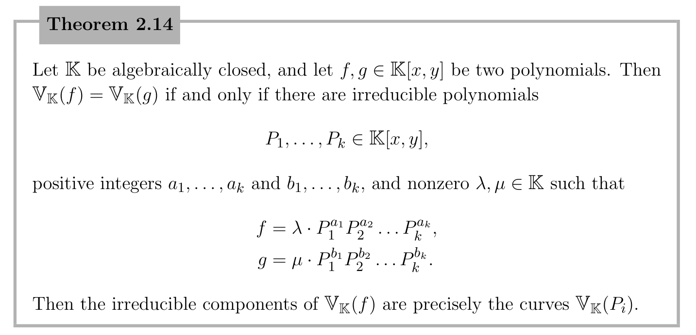

- Let $k$ be a field. Let $f_1,\cdots,f_m\in k[x_1,\cdots,x_n]$. The *affine algebraic set* (also called *affine variety* here) defined by these is
  $$
  V_k(f_1,\cdots,f_m) := \{a=(a_1,\cdots,a_n)\in k^n: f(a)=\cdots=f_m(a)=0\}.
  $$
- An *affine plane curve* is an affine variety cut out by a single non-constant polynomial in two variables.
- The *degree* of an affine plane curve $C=V(P)$ is defined as $\deg P$.
- ### ideals
- The ideal generated by a subset $X \subset R$ is denoted $I(X) \subset R$.
- Stated the Hilbert basis theorem: Any ideal $I \subset k[x_1,\cdots,x_n]$ is finitely generated.
- Define $V(I)$, and showed that if $I=\langle f_1,\cdots,f_m \rangle$, then $V(I) = V(f_1,\cdots,f_m)$.
- Lemma. If $V_1$ and $V_2$ are affine algebraic sets in $k^n$, then their intersection and union are affine algebraic sets.
	- Proof. $V(I_1 + I_2) = V(I_1)\cap V(I_2)$ and $V(I_1I_2) = V(I_1)\cup V(I_2)$.
- ### points and irreducible plane curves
- Prop. If $k$ is alg closed, then any plane curve $C \subset k^2$ has infinitely many points.
- A plane curve $C$ is called *irreducible* if every time we write $C=V_1 \cup V_2$ as a union of plane curves, then $C=V_1$ or $C=V_2$.
- Stated the [weak Nullstellensatz]([[Nullstellensatz]]): If $k$ is alg closed, then $V(I)=\varnothing$ iff $1\in I$.
- Prop. Let $k$ be alg closed, $f$, $g\in k[x_1,\cdots,x_n]$. If $f$ is irreducible and $V(f)\subset V(g)$, then $f\mid g$.
	- Proof. Use the Rabinowitsch trick: adding an extra variable $t$, we have $V(f,tg-1)=\varnothing$, so by weak Nullstellensatz, $1\in\langle f,tg-1\rangle$.
	- This means there are $a,b\in k[x_1,\cdots,x_n,t]$ such that $af+b(tg-1)=1$.
	- Now take $t=1/g$, resulting in the rational expression
	  $$
	  a(x_1,\cdots,x_n,g^{-1})f(x_1,\cdots,x_n) = 1,
	  $$
	  and multiplying by a large power of $g$ to clear the denominators, the result is of the form
	  $$
	  \widetilde a f = g^N.
	  $$
	- Since $f$ is irreducible and $k[x_1,\cdots,x_n]$ is UFD, the result follows. QED
- Theorem. Let $k$ be alg closed. A plane curve $C\subset k^2$ is irreducible if and only if $C=V(P)$ for some irreducible, non-constant $P\in k[x,y]$.
	- Proof. Trivial.
- Easy corollary: {:height 198, :width 394}
- ### projective space
- The $n$-dimemsional *projective space* $\P^n$ is the set of $1$-dimensional subspaces of $k^{n+1}$.
-