- Let $k$ be a field. Let $f_1,\cdots,f_m\in k[x_1,\cdots,x_n]$. The *affine algebraic set* (also called *affine variety* here) defined by these is
  $$
  V_k(f_1,\cdots,f_m) := \{a=(a_1,\cdots,a_n)\in k^n: f(a)=\cdots=f_m(a)=0\}.
  $$
- An *affine plane curve* is an affine variety cut out by a single non-constant polynomial in two variables.
- The *degree* of an affine plane curve $C=V(P)$ is defined as $\deg P$.
- ### ideals
- The ideal generated by a subset $X \subset R$ is denoted $I(X) \subset R$.
- Stated the Hilbert basis theorem: Any ideal $I \subset k[x_1,\cdots,x_n]$ is finitely generated.
- Define $V(I)$, and showed that if $I=\langle f_1,\cdots,f_m \rangle$, then $V(I) = V(f_1,\cdots,f_m)$.
- Lemma. If $V_1$ and $V_2$ are affine algebraic sets in $k^n$, then their intersection and union are affine algebraic sets.
	- Proof. $V(I_1 + I_2) = V(I_1)\cap V(I_2)$ and $V(I_1I_2) = V(I_1)\cup V(I_2)$.
- ### points and irreducible plane curves
- Prop. If $k$ is alg closed, then any plane curve $C \subset k^2$ has infinitely many points.
- A plane curve $C$ is called *irreducible* if every time we write $C=V_1 \cup V_2$ as a union of plane curves, then $C=V_1$ or $C=V_2$.
- Stated the [weak Nullstellensatz]([[Nullstellensatz]]): If $k$ is alg closed, then $V(I)=\varnothing$ iff $1\in I$.
- Prop. Let $k$ be alg closed, $f$, $g\in k[x_1,\cdots,x_n]$. If $f$ is irreducible and $V(f)\subset V(g)$, then $f\mid g$.
	- Proof. Use the Rabinowitsch trick: adding an extra variable $t$, we have $V(f,tg-1)=\varnothing$, so by weak Nullstellensatz, $1\in\langle f,tg-1\rangle$.
	- This means there are $a,b\in k[x_1,\cdots,x_n,t]$ such that $af+b(tg-1)=1$.
	- Now take $t=1/g$, resulting in the rational expression
	  $$
	  a(x_1,\cdots,x_n,g^{-1})f(x_1,\cdots,x_n) = 1,
	  $$
	  and multiplying by a large power of $g$ to clear the denominators, the result is of the form
	  $$
	  \widetilde a f = g^N.
	  $$
	- Since $f$ is irreducible and $k[x_1,\cdots,x_n]$ is UFD, the result follows. QED
- Theorem. Let $k$ be alg closed. A plane curve $C\subset k^2$ is irreducible if and only if $C=V(P)$ for some irreducible, non-constant $P\in k[x,y]$.
	- Proof. Trivial.
- Easy corollary: {:height 198, :width 394}
- ### projective space
- The $n$-dimemsional *projective space* $\P^n$ is the set of $1$-dimensional subspaces of $k^{n+1}$. This is also
  $$
  \P^n = \frac{k^{n+1}\setminus\{0\}}{k^\times}.
  $$
  A point will be written as $[x_0,\cdots,x_n]$.
- Affine charts.
- Say $f\in k[x_1,\cdots,x_n]$ is *homogeneous of degree* $d$ if $f(\lambda x_0,\cdots,\lambda x_n)=\lambda^d f(x_0,\cdots,x_n)$ for all $\lambda\in k$ and $(x_0,\cdots,x_n)\in k^{n+1}$.
- A *projective variety* is the vanishing locus of some homogeneous polynomials $f_1,\cdots,f_m$.
- Trivial: 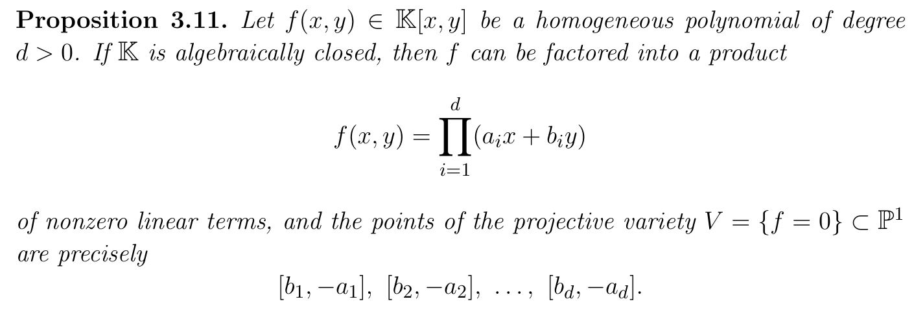{:height 189, :width 511}
- A *projective plane curve* of degree $d>0$ is the set $C=\{[x,y,z]\in\P^2:P(x,y,z)=0\}$ for some non-constant homogeneous $P$ of degree $d$.
- All these properties hold for projective plane curves as well:
	- 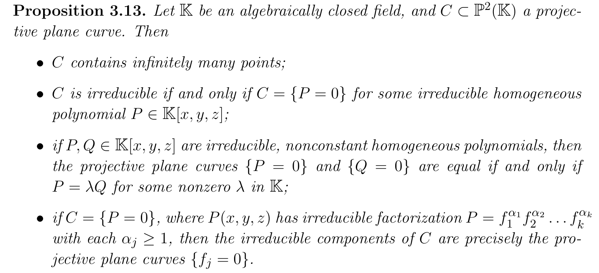{:height 290, :width 622}
	- Here we're using the fact that if $f=gh$ and $f$ is homogeneous then $g$ and $h$ are homogeneous. This can be proved by decomposing $g$ and $h$ into homogeneous parts.
- A projective plane curve over $\C$ is compact.
- We define the *projectivization* of $V(P)$ by *homogenizing* the polynomial $P\in k[x,y]$.
	- If $f\in k[x,y]$ has degree $d$, its homogenization is defined as $F(x,y,z)=z^d f(x/z,y/z)$.
	- $F$ is then homogeneous of degree $d$ and satisfy $F(x,y,1)=f(x,y)$. $F$ is not a multiple of $z$.
- 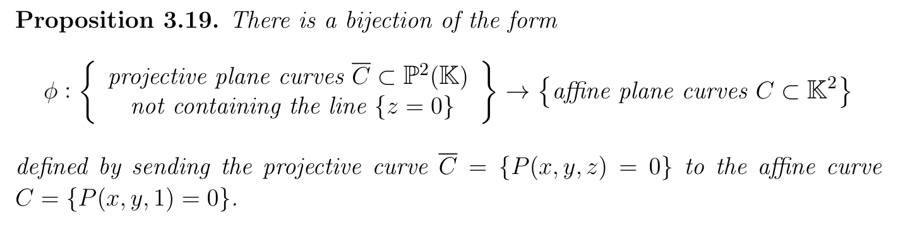
- 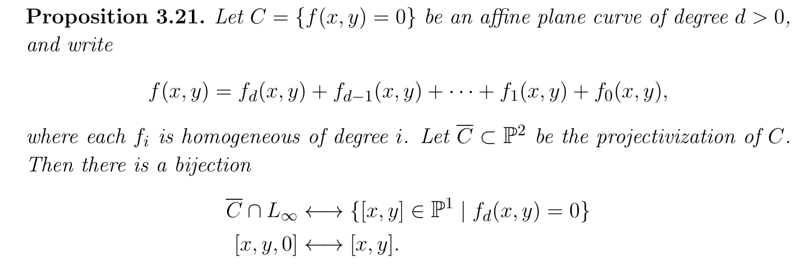
- ### singular points
- We say $C=\{f(x,y)=0\}\subset k^2$ is smooth at a point $(a,b)$ with $f(a,b)=0$ if
  $$
  (f_x(a,b),f_y(a,b))\neq(0,0).
  $$
	- In this case there is the tangent line $T_pC=\{f_x(a,b)(x-a)+f_y(a,b)(y-b)=0\}$.
- We only define this for projective plane curves in the case $\operatorname{char} k=0$.
	- 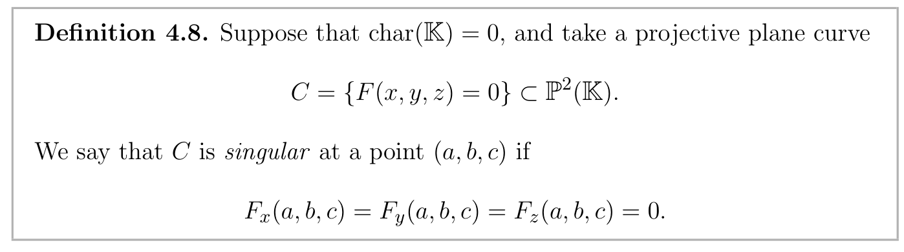
	- 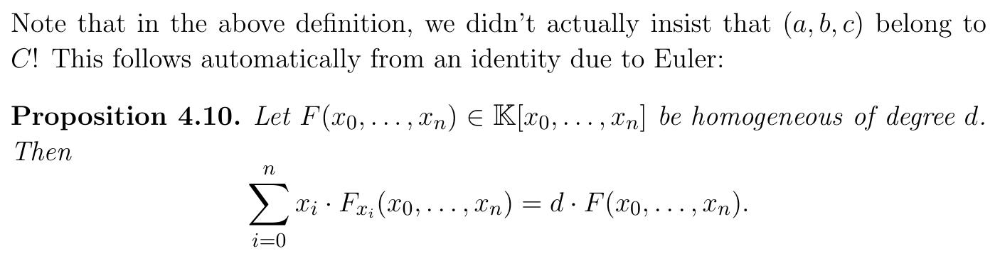
	- If $p=[a,b,c]\in\overline C$ is a smooth point then the tangent line is
	  $$
	  T_p\overline C = \{F_x(a,b,c)(x-a)+F_y(a,b,c)(y-b)+F_z(a,b,c)(z-c)=0\}.
	  $$
	  By Euler's identity, this is also $\{F_x(a,b,c)x+F_y(a,b,c)y+F_z(a,b,c)z=0\}$.
- Let $C$ be an affine plane curve, then $(a,b)\in C$ is singular if and only if $[a,b,1]\in\overline C$ is singular.
- Let $C$ be a projective plane curve over an alg closed field, and suppose two different irreducible components $C_1, C_2\subset C$ intersect at a point $p$. Then $C$ is not smooth at $p$.
	- Proof. Trivial.
	- Combined with Bezout's theorem, this implies: A smooth projective plane curve over an algebraically closed field is irreducible.
- ### projective transformations
- 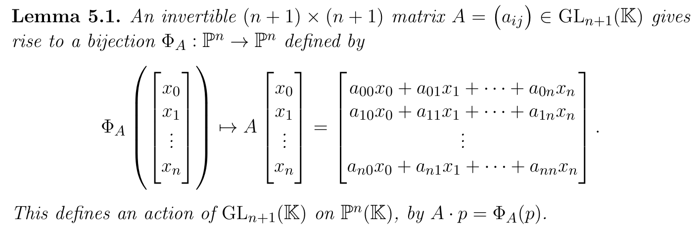
- 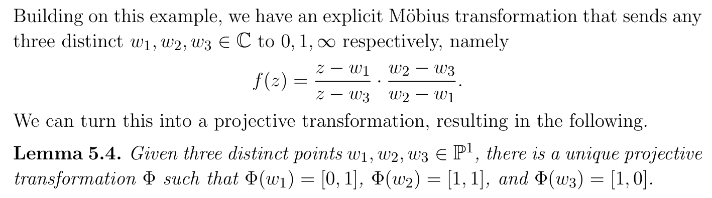
- 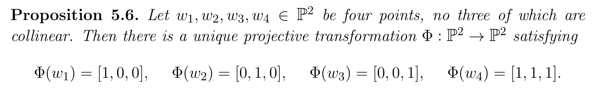
- Projective transformations preserve the most important properties of projective plane curves.
	- 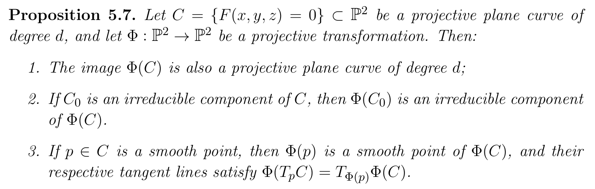
- ### resultant
- 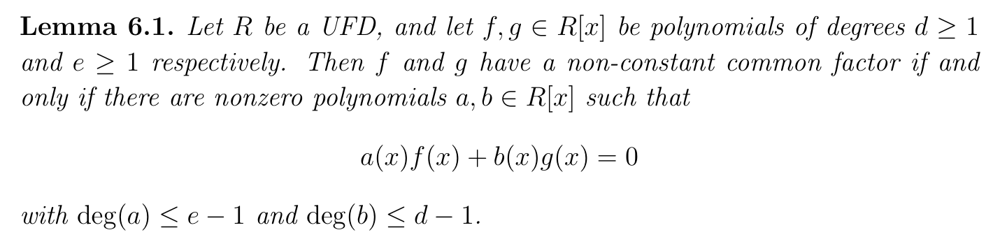{:height 198, :width 778}
-
-