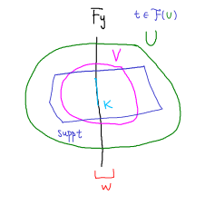

- Lemma. Let $f:X\to Y$ be a map between LCH spaces. Let $\mc F$ be a sheaf on $X$.
  $$
  (R^nf_!\mc F)_y = H_c^n(F_y, \mc F|_{F_y})
  $$
  for all $y\in Y$ and $n\geq0$.
	- Definition of [[Proper pushforward]]
	- This is a special case of the [[Proper base change theorem]].
- ### Proof
- It suffices to prove the statement for $n=0$. We will prove that the restriction map
  $$
  (f_!\mc F)_y \longto \Gamma_c(F_y,\mc F)
  $$
  is a bijection.
- ### Injectivity
- Suppose $s\in (f_!\mc F)(U)$, i.e. $s\in \mc F(f^{-1}(U))$ satisfies $\operatorname{supp} s\to U$ is proper, and $s|_{F_y}=0$.
- Then $U\setminus f(\operatorname{supp} s)$ is an open nhood of $y$ such that $s|_V=0$. Thus $s_y=0$.
- ### Surjectivity
- Let $s\in\Gamma_c(F_y,\mc F)$. So $K:=\operatorname{supp}s$ is compact.
- By [[Sections over compact subset]], we have
  $$\varinjlim_{U\supset K}\Gamma(U,\mc F) = \Gamma(K,\mc F),$$
  so there is $U\supset K$ and $t\in\mc F(U)$ such that $t|_{K}=s|_K$.
- Shrink $U$ so that $t|_{U\cap F_y}=s|_{U\cap F_y}$.
	- This is easy: choose an open nhood around each point in $K$ on which $t$ and $s$ fully agree, and let $U$ be the union of all such.
	- The reason we can't just say $t=s|_U$ is because the latter is simply not defined.
- Take an open nhood $V$ of $K$ such that $\overline V$ is compact and $\overline V\subset U$.
- Now, $\overline V\cap\supp t$ is a compact subset, while $\overline V\cap\supp t\cap F_y=K$. It follows that
  $$y \notin f\left( \overline V\cap\supp t\setminus V \right),\text{ a closed set}.$$
- Let $W$ be an open nhood of $y$ disjoint from this set. Then $f^{-1}(W)\cap\overline V\cap\supp t \subset V$. We can thus extend $t|_{f^{-1}(W)\cap V}$ to a section $\tilde s\in \Gamma(f^{-1}(W),\mc F)$ by zero, i.e., set
  $$\tilde s|_{f^{-1}(W)\setminus (\overline V\cap\,\supp t)} := 0.$$
- #+BEGIN_CENTER
  {:height 323, :width 347}
  #+END_CENTER
- Since $\supp \tilde s \subset \overline V$ is compact,